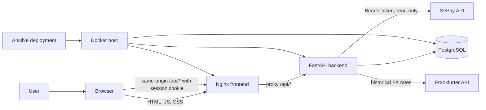
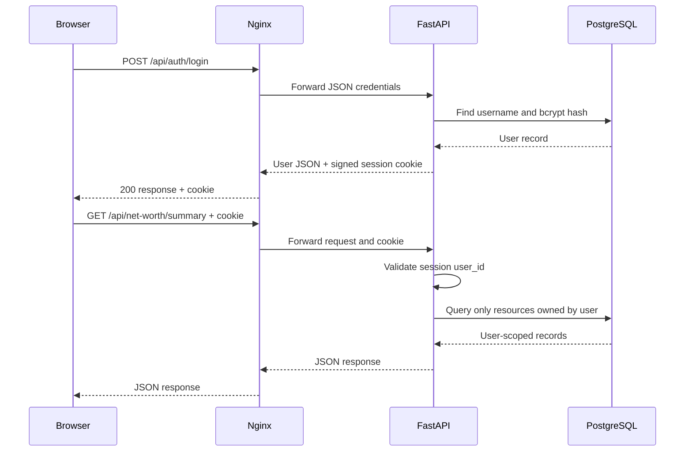
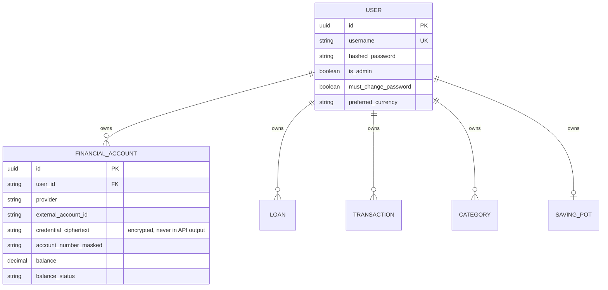
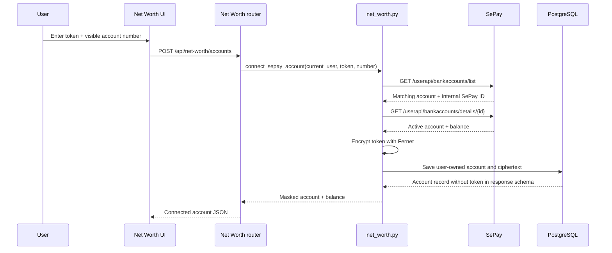
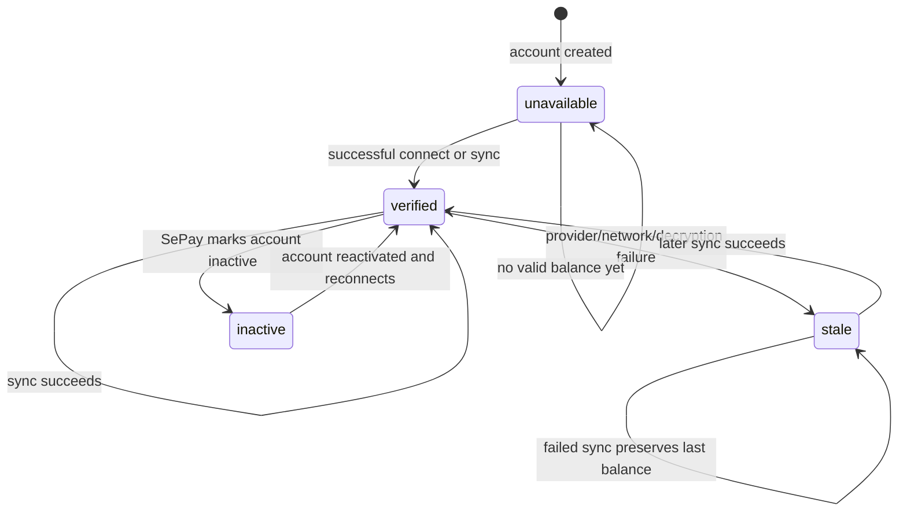
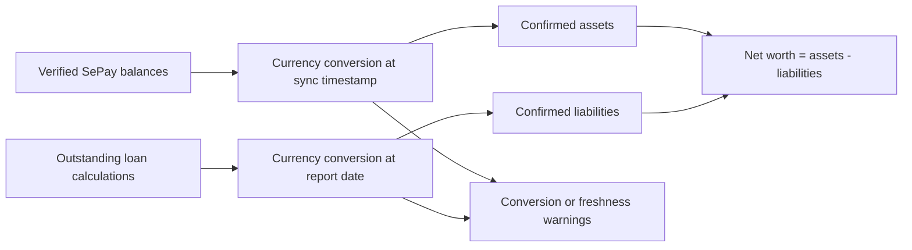
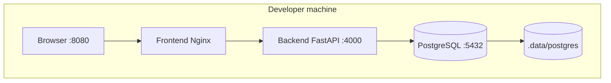
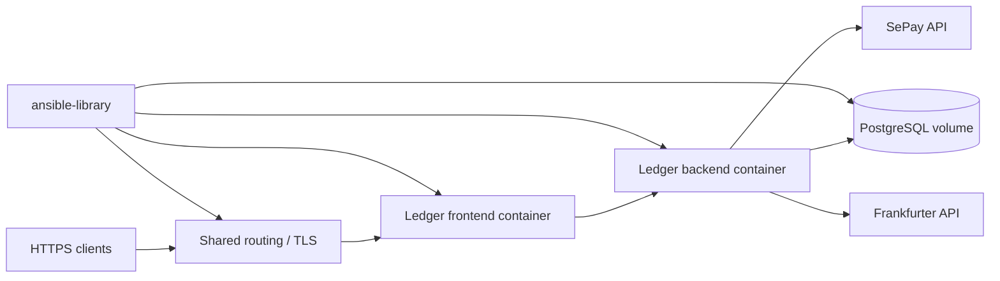

# ApexVoid Ledger architecture

This document explains the runtime architecture, security boundaries, data
ownership, and deployment topology of ApexVoid Ledger. It is written for
developers and operators who need to understand where a request goes and
which component owns each responsibility.

## System overview

ApexVoid Ledger is a same-origin web application:

- The React frontend is compiled into static files and served by Nginx.
- Nginx serves the single-page application and proxies `/api/*` to FastAPI.
- FastAPI owns authentication, authorization, business rules, calculations,
  provider integrations, and database access.
- PostgreSQL stores users and financial records.
- SePay supplies read-only bank-account balances for accounts explicitly
  connected by each Ledger user.
- Frankfurter supplies historical reference exchange rates when a report needs
  currency conversion.



The browser never calls SePay or the exchange-rate provider directly. This
keeps provider credentials and integration policy on the backend.

## Runtime services

| Service | Local container | Production role | Responsibility |
| --- | --- | --- | --- |
| Frontend | `apexvoid-ledger-frontend-1` | Nginx container behind shared routing | Serves the React SPA and proxies `/api/` to the backend. |
| Backend | `apexvoid-ledger-backend-1` | FastAPI container | Session auth, API routers, domain logic, calculations, migrations, and provider calls. |
| PostgreSQL | `apexvoid-ledger-postgres-1` | PostgreSQL container with persistent volume | Durable application data and encrypted SePay credential ciphertext. |
| Shared routing | Host-level routing project | Public HTTPS entry point | Terminates or routes public traffic to the frontend container in production. |

Local Docker publishes the frontend on port `8080`, the backend on `4000`,
and PostgreSQL on `5432`. Production uses the external routing network and
does not need to publish those container ports publicly.

## Request and authentication flow

Authentication is session-based rather than token-based for the Ledger UI. The
backend sets a signed Starlette session cookie after a successful login. API
requests use same-origin relative URLs and include that cookie automatically.



Password and currency onboarding are separate gates after login. A user with
`mustChangePassword=true` can still reach `/me`, `/change-password`, and the
currency endpoint, but protected financial routes remain blocked until the
onboarding requirements are complete.

## Frontend structure

The frontend is a React/Vite single-page application. `App.tsx` defines the
route tree and the guards enforce the main UI boundaries:

```mermaid
flowchart TD
    App[App router]
    App --> Login[/login]
    App --> AuthGuard[RequireAuth]
    AuthGuard --> Onboarding[/change-password and /select-currency]
    AuthGuard --> Layout[Authenticated layout]
    Layout --> Dashboard[/dashboard]
    Layout --> CashFlow[/cashflow]
    Layout --> NetWorth[/net-worth]
    Layout --> SavingPot[/saving-pot]
    Layout --> Loans[/loan and /loan/:id]
    Layout --> Planning[/monthly-routine, /budget, /monthly-close]
    Layout --> AdminGuard[RequireAdmin]
    AdminGuard --> Home[/home]
    AdminGuard --> Users[/settings/users]
```

Pages use hooks for loading and mutation state. `frontend/src/api.ts` is the
single HTTP client layer: it sends same-origin requests, parses API errors,
and clears client auth state when an authenticated request returns `401`.

## Backend structure

The backend is intentionally split into thin HTTP routers and domain modules:

| Layer | Location | Responsibility |
| --- | --- | --- |
| Application entrypoint | `backend/app/main.py` | FastAPI app, session middleware, router registration, health endpoint. |
| Auth boundary | `backend/app/auth.py`, `routers/auth.py` | Bcrypt verification, signed sessions, admin checks, onboarding gates. |
| HTTP routers | `backend/app/routers/` | Request validation, ownership lookup, response shaping, and HTTP error mapping. |
| Domain services | `backend/app/net_worth.py`, `cashflow.py`, `saving_pot_domain.py`, and related modules | Business rules, calculations, synchronization, and transactional updates. |
| Provider clients | `backend/app/sepay.py`, `exchange_rates.py` | External HTTP calls, response normalization, timeout handling, and safe provider errors. |
| Persistence | `backend/app/models.py`, `database.py` | SQLAlchemy models, sessions, constraints, and database connection setup. |
| Schema/migrations | `backend/app/schemas.py`, `backend/alembic/versions/` | API contracts and incremental PostgreSQL changes. |

Routers should remain responsible for HTTP concerns. Provider response parsing,
financial calculations, and synchronization policy belong in domain or provider
modules so they can be tested without a live browser request.

## Data ownership and tenant isolation

Every financial resource is scoped to the authenticated `User`. The important
ownership relationships are:



The diagram shows logical ownership. The database schema uses explicit foreign
keys for newer user-owned resources; all routers still apply an authenticated
user filter even where an older table uses a plain user-id column.

The API does not trust an object ID by itself. Every lookup combines the object
ID with the current user's ID, so another user's resource behaves like a
missing resource and returns `404`.

## SePay integration boundary

SePay is an external read-only balance provider. The shared deployment key is
used only to encrypt credentials at rest; the actual API token is supplied by
the individual user.



The database stores `credentialCiphertext`, never the plaintext token. The
response schema exposes the provider, masked account number, balance, status,
and timestamps, but not the credential ciphertext.

## Balance synchronization lifecycle



Synchronization is guarded per account and rate-limited to five minutes. A
failed synchronization does not replace a known balance with zero. Instead,
the last balance is retained and the UI reports `stale`, `inactive`, or
`unavailable`. Only verified balances are included in confirmed net worth.

## Net worth calculation

Net worth combines two independent sources:



Cash-flow transactions, expected income, saving-pot balances, and scheduled
loan payments are not added again as net-worth assets or liabilities. A saving
pot may already be represented by a connected bank balance, so including it
separately would double-count money.

If a required exchange rate is unavailable, the response marks valuation as
incomplete rather than presenting a misleading complete total.

## Deployment topology

### Local Docker Compose



The local database bind mount preserves users and test data across image
rebuilds and ordinary `docker compose down`. Delete `.data/postgres` only when
you intentionally want a clean database.

### Production



The production Compose template attaches frontend and backend to the external
`routing` network. Runtime secrets are rendered from the encrypted Ansible
vault. User SePay tokens are not placed in that vault; they are connected and
encrypted after users sign in.

## Configuration and secret boundaries

| Secret or setting | Owner | Storage/use |
| --- | --- | --- |
| `SECRET_KEY` | Operator | Backend environment; signs session cookies. |
| `SEPAY_CREDENTIAL_ENCRYPTION_KEY` | Operator | Backend environment; decrypts stored user SePay credentials. |
| `DATABASE_URL` | Operator | Backend environment; database connection. |
| PostgreSQL credentials | Operator | PostgreSQL environment and encrypted deployment vault. |
| SePay API token | Individual user | Submitted over the authenticated UI, then Fernet-encrypted in `FinancialAccount`. |
| SePay bank account number | Individual user | Used to resolve the provider account; only a masked value is returned/stored for display. |

Changing or losing the Fernet key makes existing SePay ciphertext unreadable.
Database backups and the Fernet key therefore need coordinated protection.
Changing the key requires restoring the old key or making every user reconnect.

## Database migrations

Alembic migrations run before the backend starts in both local and production
container workflows. The relevant Net Worth migrations are:

- `0019_add_financial_account.py` creates user-owned financial accounts.
- `0020_add_sepay_credential.py` adds encrypted per-user SePay credential
  storage and changes uniqueness to user + provider + external account.

Do not edit an already-applied migration. Add a new migration for a schema
change, and verify it against a copy of the production database before
deployment.

## Operational checks

```bash
docker compose ps
curl -fsS http://localhost:8080/api/health
docker compose logs --tail=100 backend
```

When investigating SePay issues, inspect status and error messages but never
log or paste the `Authorization` header, plaintext token, Fernet key, session
secret, or database password.
